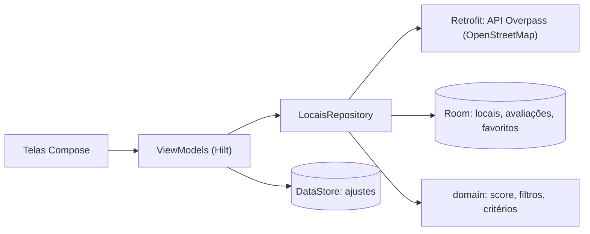

# Roda Manaus

> **"Tem rampa nesse museu?"** O Roda Manaus é um app Android focado na acessibilidade dos pontos turísticos de Manaus: mostra os locais avaliados por inclusão (rampa, banheiro adaptado, piso tátil, braille, Libras e iluminação para baixa visão).

Projeto da Avaliação Complementar (AV2, 2º bimestre) de Desenvolvimento para Dispositivos Móveis, Senac.

## O problema
Pessoas com deficiência, famílias com carrinho de bebê e pessoas com mobilidade reduzida precisam de **informação confiável antes de sair de casa**. Avaliações em sites genéricos quase nunca falam de critérios de acessibilidade.

## O que o app faz
- **Lista de locais** (`LazyColumn`) com foto, nome, cidade e nota de acessibilidade de 0 a 5.
- **Categorias** (`LazyRow`): Restaurantes, Museus, Praças, Teatros, Hotéis, Atrações e **Barreira zero** (nota 4,0 ou mais).
- **Busca** por nome ou endereço.
- **Checklist de 6 critérios** em cada local, mostrando a fonte da informação (OpenStreetMap ou comunidade).
- **Como chegar**: abre o Google Maps (ou outro app de mapas) com a rota.
- **Avaliação da comunidade**: nota, critérios observados, comentário e foto.
- **Favoritos**.
- **Ajustes**: cidade, alto contraste e tamanho do texto.
- **Funciona offline** com os locais já baixados.

## Como a nota é calculada
1. Se a comunidade já avaliou, vale a média das estrelas.
2. Senão, vale a proporção de critérios confirmados (de 6) vezes 5.
3. Sem nenhuma informação, aparece "sem avaliação".

Para cada critério, a maioria dos votos da comunidade vale mais que o OpenStreetMap.

## Requisitos da AV2 e onde estão
| Requisito | Onde está no projeto |
|---|---|
| Problema real | Seção "O problema" acima |
| Equipe e papéis | Tabela "Equipe" abaixo, commits e PRs |
| Repositório com README, issues e branches | Este README, `.github/`, `CONTRIBUTING.md` |
| `LazyColumn` + `LazyRow` | `ui/home/HomeScreen.kt`, `ui/detalhe/DetalheScreen.kt` |
| Conexão com API | `data/remote/OverpassApi.kt` (Retrofit, API Overpass do OpenStreetMap) |
| Injeção de dependência | Hilt, em `di/` |
| MVVM | `ui/*/…ViewModel.kt` + `domain/` + `data/` |
| Dados reais, sem mocks | Locais vêm da API; nada fixo no app |
| Persistência local (diferencial) | Room (`data/local/`) e DataStore (`data/ConfiguracoesRepository.kt`) |
| Pitch + demo | `docs/PITCH.md` |

## Arquitetura

A tela só mostra o estado e envia eventos. As regras (nota, filtros) ficam em `domain/` e têm testes unitários.

## Tecnologias
Kotlin · Jetpack Compose (Material 3) · Navigation Compose · Hilt · Retrofit + OkHttp + Gson · Room · DataStore · Coil · JUnit

## Dados
Locais e informações de acessibilidade vêm do **OpenStreetMap** (© colaboradores do OpenStreetMap, licença ODbL) pela API pública Overpass. Como muitos locais ainda não têm tags de acessibilidade, o app permite que a comunidade complete as informações.

## Como rodar
**Android Studio:** abra a pasta do projeto, aguarde a sincronização e rode o app (precisa de internet na primeira vez).

**APK pelo GitHub:** a aba *Actions* roda o workflow *Android CI*, que testa e gera o APK. Baixe em *Artifacts* na execução.

**Terminal:** `gradle assembleDebug` (Gradle 8.10+ e JDK 17 ou 21).

## Equipe
| Nome | Papel |
|---|---|
| Tales Silva Xavier | Integração e arquitetura: API (Retrofit), repositório, Hilt e CI no GitHub |
| Guilherme Chaves Pinheiro | Front-end: telas em Compose, navegação, componentes e tema |
| Lincoln Figueiredo da Silva | Dados: Room, DataStore, modelos e regra de pontuação |
| João Gabriel de Aguiar Negreiros | Qualidade e acessibilidade: testes, issues e PRs, README e teste com leitor de tela |

## Próximos passos
- Mapa dentro do app, com pins coloridos pela nota.
- Enviar avaliações e fotos para um servidor, compartilhando entre usuários.
- Critérios de Libras e iluminação vindos de parcerias com os locais.
